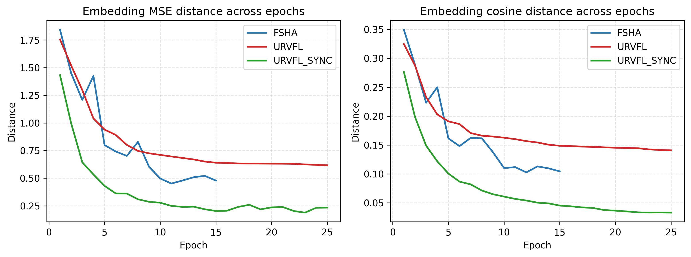
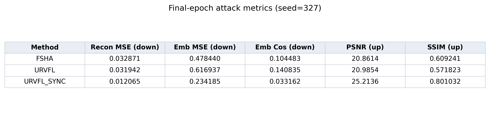
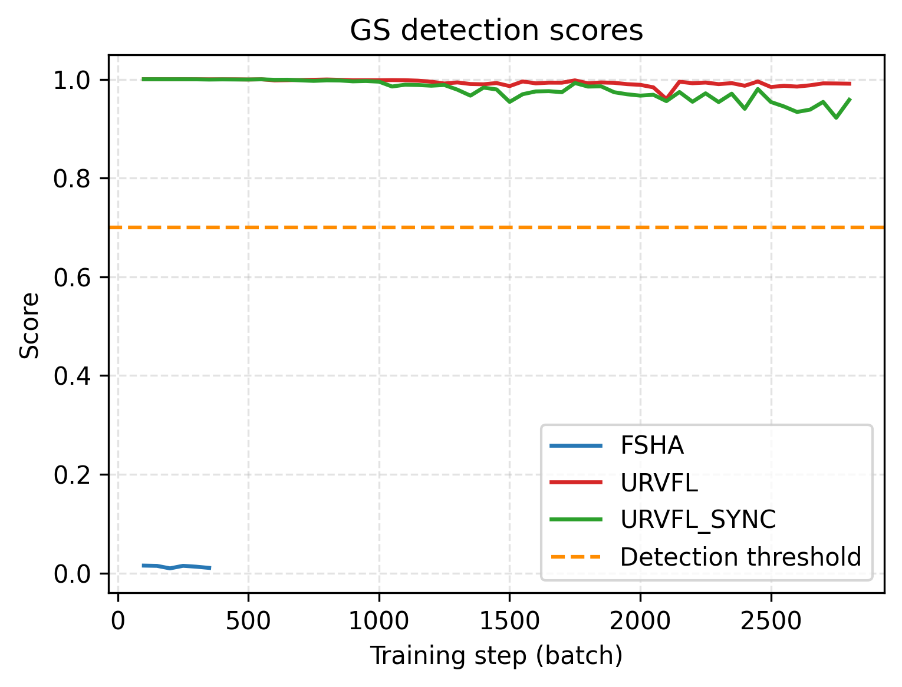

# URVFL：纵向联邦学习隐蔽数据重建攻击复现报告

> 论文：**URVFL: Undetectable Data Reconstruction Attack on Vertical Federated Learning**（NDSS 2025）  
> 作者：Duanyi Yao、Songze Li、Xueluan Gong、Sizai Hou、Gaoning Pan  
> 论文页面：[NDSS 2025](https://www.ndss-symposium.org/ndss-paper/urvfl-undetectable-data-reconstruction-attack-on-vertical-federated-learning/)  
> 预印本：[arXiv:2404.19582](https://arxiv.org/abs/2404.19582)  
> 官方代码：[duanyiyao/URVFL](https://github.com/duanyiyao/URVFL)  
> 复现者：刘明鑫

## 1. 复现工作概述

本项目复现论文提出的纵向联邦学习（Vertical Federated Learning，VFL）恶意数据重建攻击 **URVFL** 和同步版本 **URVFL_sync**，并使用 **FSHA** 作为对照攻击，考察三种方法的数据重建能力、嵌入分布对齐效果以及绕过 **Gradient Scrutinizer（GS）** 检测的能力。

当前完成的内容包括：

- 在CIFAR-10上运行FSHA、URVFL和URVFL_sync无检测训练；
- 固定随机种子为327，统一保存各方法的结果数组；
- 运行FSHA、URVFL和URVFL_sync的GS检测训练；
- 保存GS检测分数和梯度统计量；
- 修复公开代码中URVFL_sync接入GS时的配置字段错误；
- 补充结果绘图脚本，生成嵌入距离曲线、最终指标表和GS检测分数曲线。

当前复现范围为 **CIFAR-10、两个参与方、单个随机种子327**。

本次使用的主要配置如下。

| 项目 | 当前设置 |
| --- | --- |
| 数据集 | CIFAR-10 |
| 客户端数量 | 2 |
| 特征划分 | 将32×32图像沿宽度平均切分给两个客户端 |
| 攻击者 / 目标客户端 | client_1 / client_2 |
| 随机种子 | 327 |
| 辅助样本数 | 4545 |
| 训练批大小 / 测试批大小 | 128 / 64 |
| URVFL与URVFL_sync攻击训练周期| 25 epochs |
| FSHA攻击训练周期 | 15 epochs |
| GS检测训练周期 | 8 epochs |
| 学习率 | 1e-4 |
| 嵌入维度 | 16 |
| 当前代码中的GS阈值 | 0.7 |

## 2. 方法简述

### 2.1 VFL与威胁模型

在VFL中，各参与方持有同一批样本的不同特征。被动客户端使用底层模型将本地特征编码为嵌入并发送给主动客户端；主动客户端持有标签和顶层模型，计算任务损失后，将嵌入梯度返回给被动客户端。

URVFL假设主动客户端是恶意参与方。攻击者能够接收被动客户端上传的嵌入，并控制返回给被动客户端的梯度，但不能直接查询被动客户端的底层模型，也不能向其注入自定义输入。攻击目标是在这种限制下重建被动客户端的私有特征，同时避免被现有恶意训练检测方法发现。

### 2.2 URVFL

URVFL首先利用带有完整特征和标签的辅助数据训练参考编码器、参考底层模型和解码器。攻击阶段，真实被动客户端产生目标嵌入，参考模型产生带类别信息的参考嵌入。

方法的核心是带辅助分类器的判别器（Discriminator with Auxiliary Classifier，DAC）：

1. DAC区分参考嵌入与目标嵌入；
2. DAC同时利用标签保持不同类别的嵌入结构；
3. 攻击者根据DAC损失计算针对目标嵌入的恶意梯度；
4. 被动客户端使用该梯度更新自身底层模型，使目标嵌入逐渐接近参考嵌入分布；
5. 攻击者最终使用在参考嵌入上训练的解码器重建被动方特征。

类别条件对齐一方面改善了解码器的重建能力，另一方面使恶意梯度更接近正常分类任务产生的梯度，从而提高对SG和GS的隐蔽性。

### 2.3 URVFL_sync

普通URVFL在预训练结束后固定参考编码器、参考底层模型和解码器，攻击阶段主要更新被动客户端模型与DAC。URVFL_sync则在攻击过程中继续使用辅助数据同步更新参考编码器、参考底层模型、解码器和DAC。

sync并没有获得更多被动客户端原始数据。它的作用是让**参考嵌入**、DAC和解码器随着训练过程共同变化，减少固定参考模型与动态目标嵌入之间的不适配。

### 2.4 GS检测

GS根据同类别和不同类别样本的嵌入梯度统计关系计算检测分数。当前实现从约第100个训练批次开始，每隔50个批次更新一次分数，并对最近5个分数求平均；当平均分低于阈值时，判定出现攻击并停止恶意训练。

论文将GS阈值设置为0.8，但当前公开代码在 `defense.py` 中使用0.7。本次结果沿用当前代码的0.7，因此与论文表格不是严格同配置重复实验。

### 2.5 评价指标

- **Recon MSE（越低越好）**：重建数据与真实数据之间的均方误差；
- **Emb MSE（越低越好）**：参考嵌入与目标嵌入之间的均方距离；
- **Emb Cos（越低越好）**：两类嵌入之间的余弦距离；
- **PSNR（越高越好）**：重建图像的峰值信噪比；
- **SSIM（越高越好）**：重建图像与真实图像的结构相似度；
- **GS score**：GS检测分数，当前代码中低于0.7表示更加可疑。

## 3. 复现结果与分析

### 3.1 无检测训练结果





| 方法 | 结果来源 | Recon MSE ↓ | Emb MSE ↓ | Emb Cos ↓ | PSNR ↑ | SSIM ↑ |
| --- | --- | ---: | ---: | ---: | ---: | ---: |
| FSHA | 论文Table II/III | 0.0317±0.0065 | 0.4657±0.1286 | 0.1610±0.0285 | 19.7955±2.2895 | 0.5312±0.0298 |
| FSHA | 本次复现 | 0.032871 | 0.478440 | 0.104483 | 20.8614 | 0.609241 |
| URVFL | 论文Table II/III | 0.0302±0.0011 | 0.5679±0.0834 | 0.1303±0.0131 | 21.0666±0.0165 | 0.5927±0.0002 |
| URVFL | 本次复现 | 0.031942 | 0.616937 | 0.140835 | 20.9854 | 0.571823 |
| URVFL_sync | 论文Table II/III | 0.0176±0.0139 | 0.2793±0.1868 | 0.0675±0.0549 | 26.2360±0.0030 | 0.8125±0.0001 |
| URVFL_sync | 本次复现 | **0.012065** | **0.234185** | **0.033162** | **25.2136** | **0.801032** |

本次结果与论文在总体趋势上基本一致：URVFL与FSHA的最终重建MSE接近，而URVFL_sync在重建MSE、嵌入距离、PSNR和SSIM上表现最好。URVFL的嵌入距离并不一定始终小于FSHA，因此不能仅凭Emb MSE判断最终重建能力；重建效果还取决于参考编码器、解码器和类别条件对齐共同学到的表示。

论文表格报告多次实验的均值和标准差，本次结果只有seed=327的一次运行，因此只能比较数值范围和趋势，不能据此判断本次实现优于论文。

### 3.2 GS检测结果



| 方法 | GS记录数 | 分数范围 | 平均分 | 是否触发GS | 终止位置 |
| --- | ---: | ---: | ---: | --- | --- |
| FSHA | 6 | 0.0095–0.0151 | 0.0129 | 是 | 约第350个训练批次 |
| URVFL | 55 | 0.9600–1.0000 | 0.9936 | 否 | 完成8个检测epoch |
| URVFL_sync | 55 | 0.9220–1.0000 | 0.9785 | 否 | 完成8个检测epoch |

FSHA的GS分数持续低于0.7，最近5次分数的平均值满足检测条件，因此攻击在约第350个训练批次被停止。URVFL与URVFL_sync的分数始终高于当前阈值，均运行到8个检测epoch结束。这复现了论文Figure 6的核心现象：GS能够识别FSHA，但难以识别URVFL及其同步版本。

当前绘图脚本根据代码的记录规则，将GS横轴还原为实际训练批次：第一次记录约在第100批次，此后每50批次记录一次。因此55个分数的最后一个横坐标为2800；完整的8个epoch约包含2840个训练批次。

### 3.3 GS条件下的重建结果

| 方法 | 结果来源 | Recon MSE ↓ | Emb MSE ↓ | Emb Cos ↓ | PSNR ↑ | SSIM ↑ |
| --- | --- | ---: | ---: | ---: | ---: | ---: |
| FSHA-GS | 论文Table II/III | 0.1312±0.0150 | 1.5940±0.0684 | 0.3133±0.0230 | 15.1751±0.5590 | 0.3083±0.0053 |
| FSHA-GS | 本次复现 | 0.152127 | 1.982220 | 0.312764 | 14.2269 | 0.289493 |
| URVFL-GS | 论文Table II/III | 0.0302±0.0011 | 0.5679±0.0834 | 0.1303±0.0131 | 21.0666±0.0165 | 0.5927±0.0002 |
| URVFL-GS | 本次复现 | 0.022291 | 0.384818 | 0.087248 | 22.5485 | 0.677400 |
| URVFL_sync-GS | 论文Table II/III | 0.0176±0.0139 | 0.2793±0.1868 | 0.0675±0.0549 | 26.2360±0.0030 | 0.8125±0.0001 |
| URVFL_sync-GS | 本次复现 | 0.016698 | 0.291498 | 0.063219 | 23.8020 | 0.733291 |

FSHA被GS较早终止，因此重建质量明显下降。URVFL和URVFL_sync没有触发GS，仍能获得较好的重建结果。由于本次使用的GS阈值、随机种子和运行次数与论文并不完全一致，表中数值用于检查趋势，不应视为对论文均值的严格重复。

## 4. 快速启动指南

### 4.1 环境准备

当前代码在WSL/Linux与NVIDIA CUDA环境下运行，Python版本为3.9。依赖版本已经写入 `requirements.txt`。

```bash
conda create -n urvfl python=3.9
conda activate urvfl
pip install -r requirements.txt
```

若出现 `pkg_resources is deprecated`，它是setuptools相关警告，不会直接导致训练失败；需要消除警告时可以暂时使用 `setuptools<81`。若出现cuDNN执行计划警告，但训练仍继续并产生结果，则可记录环境差异后继续观察。

### 4.2 数据路径与配置

首先将 `cifar10/cifar_data_pre.py` 中CIFAR-10的 `root` 修改为本机数据目录，例如：

```python
trainset = datasets.CIFAR10(root="/path/to/URVFL/data", train=True, download=True, transform=transform_train)
testset = datasets.CIFAR10(root="/path/to/URVFL/data", train=False, download=True, transform=transform_test)
```

主要超参数位于 `cifar10/config_cifar.json`：

- `save=true`：重新预训练参考编码器、参考底层模型和解码器；
- `save=false`：加载已有预训练模型，使用前应确认脚本中的 `save_seed` 与模型文件一致；
- `epochs`：URVFL和URVFL_sync攻击轮数；
- `fsha_epochs`：FSHA攻击周期；
- `gs_epochs`：GS检测训练周期；
- `aux_size`：辅助数据数量；
- `sg_defense`、`gs_defense`：检测触发后是否停止攻击。

当前 `sync_cifar.py` 将辅助样本数直接写为4545，而不是读取 `config['aux_size']`。修改辅助数据规模时需要同步修改该脚本，或者将其统一改为读取配置。

### 4.3 运行无检测攻击

从项目根目录执行：

```bash
mkdir -p logs

python cifar10/fsha_cifar.py 2>&1 | tee logs/fsha_327.log
python cifar10/urvfl_cifar.py 2>&1 | tee logs/urvfl_327.log
python cifar10/sync_cifar.py 2>&1 | tee logs/sync_327.log
```

其中URVFL在 `save=true` 时先完成20个epoch的预训练，再运行25个攻击epoch。执行URVFL的GS检测前，应先确保 `cifar10/saved_model/` 中存在与 `save_seed` 对应的编码器、解码器和参考底层模型。

### 4.4 运行GS检测

在 `cifar10/detection_cifar.py` 中选择攻击与检测方法：

```python
atk_type = ["fsha"]      # 可改为 "urvfl" 或 "sync"
defenses = ["gs"]
```

然后分别运行并保存日志：

```bash
python cifar10/detection_cifar.py 2>&1 | tee logs/gs_fsha_327.log
python cifar10/detection_cifar.py 2>&1 | tee logs/gs_urvfl_327.log
python cifar10/detection_cifar.py 2>&1 | tee logs/gs_sync_327.log
```

每次运行前需要把 `atk_type` 改为对应方法。当前脚本默认设置为 `sync` 与 `gs`。

### 4.5 生成图表

```bash
python cifar10/plot_results.py --seed 327
```

默认读取 `cifar10/attack_result/`，并在 `cifar10/figures/` 生成：

- `attack_curves_seed327.png`；
- `attack_table_seed327.csv`；
- `attack_table_seed327.png`；
- `detection_scores_seed327.png`。

结果数组统一采用以下行顺序：

```text
Emb MSE, Emb cosine distance, Recon MSE, PSNR, SSIM
```

## 5. 遇到的困难及解决办法

### 5.1 URVFL_sync接入GS时缺少 `target_weight`

**困难：** `defense.py` 的sync分支读取 `config['target_weight']`，但 `config_cifar.json` 中没有该字段，导致GS-SYNC在第一个批次报错退出。

**解决办法：** 参考无检测的URVFL_sync实现，将解码器输入由带 `target_weight` 的拼接改为参考编码嵌入与参考底层嵌入的直接拼接，使检测分支与独立sync训练保持一致。

### 5.2 GS完整运行后的返回值与调用端不一致

**困难：** 当URVFL或URVFL_sync一直未触发GS、完整运行8个epoch后，`gradient_scru()`原本只返回梯度统计数组，而 `detection_cifar.py` 按7个返回值解包，出现 `expected 7, got 4` 等错误。

**解决办法：** 统一提前终止和完整结束两条路径的返回结构，完整返回检测分数、嵌入距离、重建指标和梯度统计量。

## 6. 可复现性与限制说明

1. 当前只完成CIFAR-10、seed=327的一次运行，而论文表格报告均值和标准差；本结果只能说明总体趋势基本一致。
2. 当前代码的GS阈值为0.7，与论文使用的0.8不同；两者不是严格同配置比较。
3. 公开仓库目前主要提供CIFAR-10实现，本项目没有复现MNIST、Tiny ImageNet、Credit和RT-IOT2022结果。
4. `set_seed()`设置了PyTorch、NumPy和Python随机种子，但没有完全固定CUDA与cuDNN的确定性行为，不同硬件可能产生小幅差异。
5. 无检测曲线保存的是每个epoch的汇总值，无法恢复论文Figure 7中每个攻击迭代的原始轨迹。

## 7. 方法解决的问题、局限与可尝试改进

### 7.1 方法解决的问题

URVFL主要解决恶意主动客户端在不能查询被动方模型、不能向被动方注入数据的条件下，如何重建被动方私有特征并绕过现有恶意训练检测的问题。

以FSHA为代表的恶意重建攻击通过改变被动客户端底层模型的训练目标实现嵌入分布迁移，但产生的梯度与正常分类训练差异较大，容易被SG和GS发现。URVFL引入带辅助分类器的判别器，将标签信息纳入分布对齐：类别信息既帮助解码器学习更清晰的类条件表示，也使恶意梯度更接近正常任务梯度。URVFL_sync进一步在攻击阶段持续更新参考模型和解码器，使参考嵌入能够随训练动态变化。

论文及本次CIFAR-10实验均表明，URVFL和URVFL_sync能够保持较好的数据重建质量，并使GS分数维持在检测阈值以上；**FSHA则被GS较早识别并停止。**

### 7.2 方法在的不足

1. **依赖带完整特征和标签的辅助数据。** 论文Figure 9已经测试辅助数据规模和异分布辅助数据，证明攻击并非只在同分布数据上有效；但攻击者仍需拥有可训练参考编码器、解码器和DAC的辅助数据。辅助数据过少或与目标数据差异过大时，参考分布质量会下降，最终影响重建效果。
2. **对参考编码器与被动模型的结构匹配较敏感。** 论文Table V已经研究不同编码器结构；当参考编码器由匹配的3-Res改为MLP时，URVFL的Recon MSE从0.0302升至0.2545。后果是攻击者不了解被动方模型结构时，重建性能可能显著下降。
3. **目标客户端增多后重建效果下降。** 论文Table VI已经测试1至5个目标客户端；URVFL的重建误差由1.3821升至1.9820。多个客户端分别学习局部特征后，跨特征相关信息更难被参考编码器和解码器恢复。

4. **“不可检测”只针对有限检测器成立。** 论文主要证明URVFL能够绕过SG和GS，但Figure 10又显示正常训练与URVFL的嵌入梯度L2范数分布存在明显差异。后果是新的梯度分布或时间序列检测器仍可能识别攻击。

### 7.3 论文没有充分研究的问题

1. **没有将L2范数差异发展成完整检测器。** 论文展示了分布差异，但没有给出完整特征、决策规则、检测率、误报率，因此尚不能确定该信号在不同数据集和训练阶段是否足够稳定。
2. **没有充分报告攻击期间的正常VFL任务性能。** 重建质量较好不等于主任务仍然正常。缺少该结果，使我们难以判断攻击是否会因分类准确率异常而暴露。
3. **没有研究针对新检测信号的适应性攻击。** 如果防御者使用L2范数检测，攻击者可能主动约束梯度范数。论文没有验证这种情况下检测是否仍然有效。
4. **没有形成检测后的隐私处置闭环。** 即使发现攻击，已经上传的嵌入和已经被重建的数据也无法撤回；单纯停止训练只能减少后续泄露。

### 7.4 值得尝试的改进方向

#### 方向一：阶段感知的多统计量URVFL检测

该方向针对“SG/GS检测不到URVFL，而论文只观察到L2范数差异但没有实现检测器”这一未解决问题。

核心方法不是简单设置一个L2阈值，而是联合使用梯度范数、窗口均值与方差、分位数、相邻梯度方向变化等特征，并分别建模训练早期、中期和后期的正常梯度分布。随后使用滑动窗口累积连续异常证据，以降低单个批次波动造成的误报。

#### 方向二：辅助数据受限条件下的URVFL稳定性增强

该方向针对URVFL依赖辅助数据的真实不足。论文已经做过辅助数据比例和异分布数据实验，因此仅重新测试这些设置不属于创新。可考虑在辅助训练阶段加入类别均衡采样、弱数据增强和嵌入一致性约束，使有限辅助数据产生更稳定的类别条件参考表示。

这一方向必须形成“辅助数据受限造成何种退化—提出针对性机制—在多种受限条件下验证”的完整逻辑。**最大风险**是数据增强仍无法缩小目标分布差距，甚至干扰DAC对齐，因此应只针对实验中最明显的一类退化设计方法。

#### 辅助模块：检测与轻量保护联动

当阶段感知检测器连续多个窗口报告高风险时，被动客户端可以暂停上传新嵌入，或临时启用梯度裁剪、表示扰动或Nopeek。该模块只能减少检测后的新增泄露，不能恢复已经泄露的数据；如果检测器本身无法识别URVFL，保护也不会触发。因此它适合与方向一形成“检测—响应”闭环。
